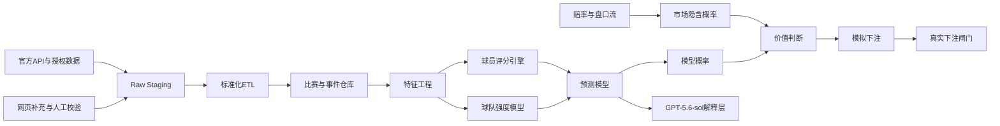
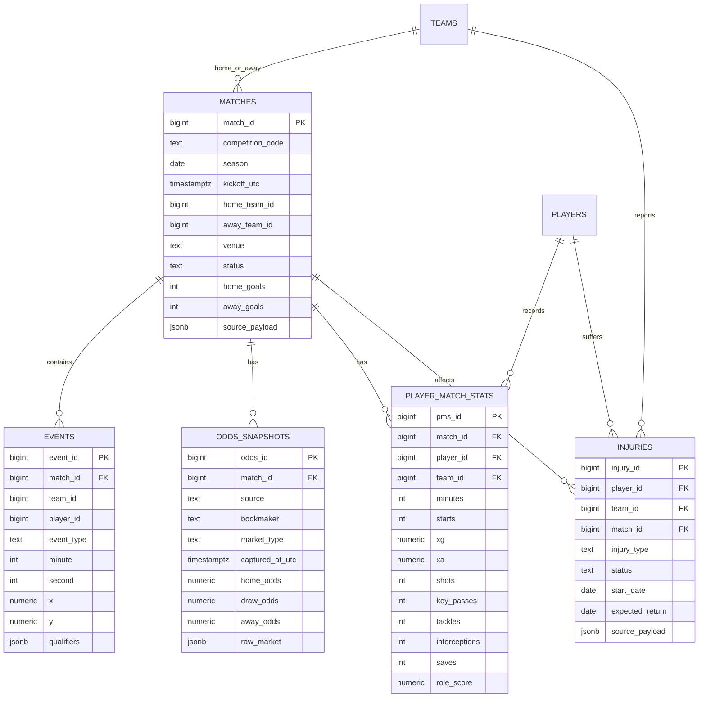
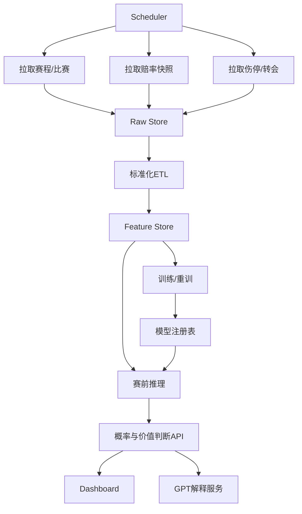

# 五大联赛量化足球系统完整技术方案

## 执行摘要

本方案建议把项目拆成四个严格分离的阶段：**赛季初数据采集期、赛季中预测期、模拟下注期、真实下注触发期**。赛季初不输出投注建议，只做比赛、事件、球员、伤停、赔率与市场变动的全量沉淀；进入赛季中后，再基于滚动样本建立球员评分、球队实力与市场价值模型；在真实下注之前，先经过一段时间的样本外预测与模拟下注验证，最后仅在满足**校准合格、封盘线优于市场、回撤可控、数据质量稳定**的条件下才开放真实下注。这个顺序与经典足球比分建模文献中“先估计进攻/防守强度，再映射到赛果概率”的思路一致，也符合现代赔率市场中“先做概率，再做价值判断”的工程原则。citeturn14search1turn14search4turn13search2

如果你希望系统尽快落地、又不一开始就支付高额企业级数据费用，最合理的路线是：**低成本 MVP 用 Sportmonks 或 API-Football 作为主比赛数据源，The Odds API 或 Betfair 作为赔率/交易数据源，FBref/Transfermarkt/Sofascore 只做校验与补充；等系统稳定后，再视预算升级到 Opta 或 StatsBomb 付费数据。** 这样做的原因是：Sportmonks 和 API-Football 都有公开价格与自助接入；The Odds API 有公开的历史与实时赔率方案；Betfair 提供官方 Exchange API 与历史数据；而 Opta/StatsBomb 更强，但主要面向企业客户或专业团队。citeturn18view1turn18view0turn27view0turn28search1turn22view2turn30view1turn6search4

从数据策略上看，建议将数据源分三层：**P1 官方/授权 API，P2 授权聚合 API，P3 网页抓取与公开网站**。P1/P2 负责生产主链路，P3 只做冗余校验、缺口修复和人工复核线索。原因非常现实：像 OddsPortal 明确写明其内容来自第三方或自身采集，并提示用户与原始来源比对；FBref 在 2026 年初还因供数方争议下架了 advanced data；Transfermarkt、FBref 的使用条款也都更适合“网站使用”而非无人值守的大规模生产抓取。因此，**生产模型不能建立在单一网页抓取站点上**。citeturn23view0turn25search2turn25search21turn9search1

在模型层面，本报告的首选方案不是单一“神经网络黑箱”，而是**混合式栈**：用 **Poisson / Dixon-Coles / Skellam** 这类可解释的计数模型做基线，用 **XGBoost 或 LightGBM** 吸收高维特征，再用**概率校准**把输出概率变成可下注的隐含分布。这样既保留足球比分建模的可解释性，又兼顾非线性特征的吸收能力，而且更适合赛季内滚动更新。citeturn14search1turn14search4turn14search10turn13search2turn13search24

关于 GPT-5.6-sol，本报告建议把它放在**解释层与策略审阅层**，不要把它当成数值计算核心。OpenAI 官方文档显示，最新模型可通过 Responses API 调用，并支持 reasoning mode 与 Structured Outputs；这非常适合让它对 Python 服务已经计算好的特征、概率、赔率差、风险信号进行结构化解释与报告生成，但不适合替代数据库、特征工程、回测和资金管理服务。citeturn29view0turn29view1turn29view2

预算、团队规模、是否购买企业级数据等要素目前均为**未指定**。因此，本报告在涉及采购与人员时，将同时给出**低/中/高三档可选方案**，其中高档企业数据部分会明确标注哪些供应商为**未公开报价/需商务询价**。citeturn18view0turn27view0turn28search1turn6search4

## 项目蓝图与分阶段里程碑

### 目标定义

这个系统的核心目标不是“直接猜比分”，而是构建一个可持续迭代的**足球量化研究与决策系统**。它至少应包含五个连续能力层：

1. **比赛与球员数据沉淀层**：获取五大联赛赛程、阵容、事件、球员表现、伤停、赔率与盘口路径。
2. **球员评分层**：按位置输出赛后评分、滚动状态分、稳定性分与波动分。
3. **球队强度层**：把球员评分聚合成球队的攻、防、中场控制、门将与整体状态曲线。
4. **预测层**：输出胜平负、进球数、大小球、双方进球、必要时延伸到球员市场。
5. **价值投注层**：比较模型概率与市场隐含概率，只识别“有价差”的比赛，而不是只猜“谁更强”。

这一目标分解与 Opta、StatsBomb、Sportmonks、API-Football 等数据商所提供的主流字段能力是匹配的：它们都能覆盖从 fixtures、lineups、events、player statistics 到 xG、odds、injuries 的数据链路，只是粒度、授权形式与价格不同。citeturn30view1turn18view1turn27view0turn20search6

### 分阶段里程碑与真实下注触发条件

| 阶段 | 建议时长 | 目标 | 输出 | 禁止事项 | 进入下一阶段条件 |
|---|---:|---|---|---|---|
| 赛季初数据采集期 | 开季后 4–8 周 | 建立全量数据仓 | 比赛库、球员赛后评分、赔率快照、伤停日志 | 不给真实下注建议 | 五大联赛连续数据完整率 ≥ 99%，关键表无主键冲突 |
| 赛季中预测期 | 第 6–10 周起 | 输出概率但不下注 | 胜平负、大小球、BTTS、比分分布 | 不做真实资金暴露 | 连续滚动 2–4 周样本外预测，概率校准稳定 |
| 模拟下注期 | 至少 200–500 笔模拟单 | 验证价值判断与资金规则 | ROI、CLV、回撤、命中率、Brier/log loss | 不做真实下注 | CLV 为正、最大回撤可承受、不同联赛表现不过度偏斜 |
| 真实下注触发期 | 仅在条件满足时 | 小仓位试运行 | 单位投注、风控限额、审计日志 | 禁止追损、禁止人工加码 | 最近 8–12 周样本外与模拟结果仍为正且校准未劣化 |

建议把**真实下注触发**写成硬性规则，而不是情绪判断。推荐触发门槛为：最近 8–12 周样本外预测对比市场基线仍显著更优；模拟下注累计至少 200–500 笔；Closing Line Value 为正；最大回撤不超过预设阈值；并且数据链路没有出现持续缺失、赛程/阵容同步异常。这个设计的核心原因，是足球模型在赛季初受阵容磨合、转会和伤停扰动很大，只有当滚动强度参数和状态曲线足够稳定后，概率与赔率的差值才有工程意义。citeturn14search1turn14search4turn14search10

### 推荐的系统流程



## 数据源优先级与采集策略

### 数据源优先级结论

生产级架构建议采用以下顺序：

- **P1 官方/授权接口**：Betfair Exchange API、The Odds API、Sportmonks、API-Football、football-data.org、Opta、StatsBomb 付费数据。
- **P2 授权开放/研究数据**：StatsBomb Open Data。
- **P3 网页与聚合站点**：Sofascore、FBref、Transfermarkt、OddsPortal。

原因在于：P1/P2 可提供更稳定的 schema、调用配额与可追踪的更新策略；P3 虽然信息有价值，但条款、反爬、字段漂移和页面重构风险都更大。OddsPortal 自己也说明其内容来自第三方或自行收集，并建议用户与原始来源比对；FBref 还在 2026 年 1 月因为供数协议问题移除了 advanced data。citeturn23view0turn25search2

### 数据源比较表

| 数据源 | 五大联赛覆盖 | 成本与接入 | 更新频率/延迟 | 可用字段 | 语言 | 结论 |
|---|---|---|---|---|---|---|
| **Opta / Stats Perform** | 覆盖广，官方宣称 3900+ competitions；Opta Vision 覆盖 80+ competitions | 企业级，公开页未披露标准价，通常商务询价 | 实时/近实时 | 实时比分、event data、advanced metrics、tracking/vision、predictions | 英文为主 | **高档首选**，适合成熟生产与高预算。citeturn6search4turn6search10turn6search17 |
| **StatsBomb 付费** | 覆盖 190+ competitions，40+ key leagues 带 player-location | 付费，销售接入；支持 API 与 JSON/XML/CSV | 专业级实时/赛后高粒度 | 3400+ events/match、360、xG、OBV、pressures | 英文为主 | **高档首选**，最适合事件级与空间模型。citeturn30view1 |
| **StatsBomb Open Data** | 有五大联赛历史开放样本，但不是当前赛季全覆盖 | 免费，GitHub JSON | 历史数据，不适合作为实时主源 | competitions、matches、events、lineups、three-sixty | 英文为主 | **研究/原型极好，生产主源不够**。citeturn24view3turn5search6 |
| **Sportmonks** | 2500+ leagues，自助式接入 | Free plan；Starter €29/月起；公开 pricing | API 级更新；官方 lineups、events、stats；odds/xG 为 add-on | fixtures、results、lineups、events、player stats、injuries/sidelined、odds、xG、pressure index | 英文为主 | **中档主源首选**，性价比高。citeturn18view1turn18view0turn19search13 |
| **football-data.org** | 明确支持 PL、PD、BL1、SA、FL1 | 免费 10 req/min；标准版 30 req/min | 文档主打 live scores，但公开页未给秒级 SLA | competition、match、team、person、lineup、bookings、team statistics、UTC 时间戳 | 英文为主 | **低成本稳定补充源**，但不适合深度球员事件建模。citeturn15view0turn17view0turn16view2turn16view1 |
| **API-Football** | 1200+ leagues & cups | 免费 100 req/day；$19/$29/$39 月付档 | API 聚合更新 | fixtures、events、lineups、players、injuries、sidelined、pre/in-play odds、statistics、predictions | 英文为主 | **低中档主源**，上手快，适合 MVP。citeturn27view0turn20search0turn20search6 |
| **Sofascore** | 官方称 200+ competitions rated | 公开站点/小部件免费；未见公开通用开发者 API | rating 实时更新，比赛中每名球员 60 次更新 | live scores、match stats、player ratings、heatmaps | 英文为主，网页多语言 | **辅助监控源**，不要把其评分直接当训练标签。citeturn15view4turn8search11 |
| **FBref** | 100+ competitions 的统计站点 | 网站公开；Stathead 订阅增强；无公开稳定 API | 更适合赛后/赛季分析 | player/team/league stats、scouting reports | 英文为主 | **二级参考源**。尤其注意：2026 年 1 月 advanced data 被移除。citeturn7search0turn25search4turn25search2 |
| **Transfermarkt** | 覆盖广 | 网站型；未见官方公开 API；条款保护数据库与服务权利 | 页面级更新，偏赛后/转会窗口 | 市场价值、转会、合同、伤停、阵容 | 多语言网页，英文常用 | **补充上下文源**，适用于转会/合同/市场价值，不宜做主链路。citeturn9search2turn9search1 |
| **OddsPortal** | 明确覆盖五大联赛与历史赔率归档 | 网站型；本次检索未见公开开发者 API | 页面更新；支持 archived results/historical odds | 多博彩公司价格比较、closing odds、历史赔率轨迹 | 英文为主 | **仅做历史赔率补充与校验**，不做主链路。citeturn23view1turn23view2turn23view0 |
| **Betfair Exchange API** | 足球市场广泛，可配历史数据购买 | 官方开发者平台；有请求权重限制；非交互登录需证书 | 官方交易级数据 | exchange odds、market catalogue/book、bet placement、historical data | 英文为主 | **赔率与成交主源首选**，尤其适合长期价值投注研究。citeturn22view2turn22view0turn22view1 |
| **The Odds API** | 覆盖 EPL 等足球联赛，支持部分 player props | 免费 500 credits/月；$30 起；历史赔率付费 | 足球 featured markets 赛前 60 秒、赛中 40 秒；exchange 20/10 秒 | h2h、spreads、totals、历史赔率、部分球员市场 | 英文为主 | **赔率聚合主源首选**，特别适合快捷接入。citeturn28search1turn21search0turn18view3turn15view7 |

### 推荐的数据采购组合

如果预算**未指定**，建议按三档落地：

| 档位 | 比赛/球员主源 | 赔率主源 | 补充源 | 适合阶段 |
|---|---|---|---|---|
| 低档 | API-Football 或 football-data.org | The Odds API 免费/Starter | FBref、Transfermarkt、Sofascore | MVP、赛季初上线 |
| 中档 | Sportmonks + API-Football 备份 | The Odds API + Betfair | OddsPortal 历史归档、Transfermarkt | 稳定生产、模拟下注 |
| 高档 | Opta 或 StatsBomb 付费 | Betfair + 官方/授权 bookmaker feed | Sportmonks 作热备 | 研究深化、真实下注 |

低档能较快做出 MVP，但深度事件、压力、空间与赔率质量都会受限。中档最均衡。高档才适合长期研究球员级 props、空间压迫与高频市场微结构。citeturn18view1turn27view0turn28search1turn22view2turn30view1turn6search4

### 数据采集实现细节

工程上必须坚持**API 优先、抓取补充**。对于授权 API，采集策略应采用：按比赛日拉取 fixtures；赛前轮询预计阵容与伤停；开赛后按固定频率拉取 live state；赛后补拉事件、球员统计、阵容确认与 closing odds；随后再跑一次 T+1 修复任务，专门纠正赛后补录事件和赔率快照缺口。football-data 的 match 资源已经展示了 `utcDate`、`status`、`lastUpdated`、`lineup`、`statistics`、`bookings` 等关键结构；Sportmonks 也明确把 fixtures、events、lineups、statistics、player statistics、sidelined 组织成统一实体体系；API-Football 则把 fixture 作为串联 events、lineups、player performances、odds、predictions 的主键。citeturn16view3turn16view2turn16view1turn19search9turn19search13turn20search6

对于网页型来源，只允许做**合规、低频、非绕过式补充采集**：尊重条款与 robots；严格限速；优先使用条件请求、缓存与页面 diff；禁止绕过登录、验证码与付费墙；出现条款不明或供数纠纷时，立即降级为人工校验源。这样设计的原因很直接：FBref 已明确写出“未经许可或授权使用被明令禁止”；Transfermarkt 条款强调其数据库与技术权利；OddsPortal 也提醒用户将其内容与原始来源比对。citeturn25search21turn9search1turn23view0

关于**xG 与事件数据**，如果预算允许，优先使用 StatsBomb 或 Opta/Sportmonks 的原生事件与 advanced metrics。StatsBomb 付费数据主打每场 3400+ 事件、freeze-frame/360、pressures 与 xG/OBV；Opta 公开强调事件定义在全球采集团队中保持一致；Sportmonks 则把 xG 与 pressure index 作为明确 add-on。只有在没有高质量事件源时，才考虑用网站端 xG 做二次校验。xG 本质上是“某次射门转化为进球的概率”，这类指标比原始进球数更适合作为球队与球员状态的底层特征。citeturn30view1turn15view6turn18view0turn13search6turn25search25

时间处理必须统一为**UTC 入库 + 本地展示层转换**。数据源层面，football-data 的字段明确采用 `utcDate`；赔率端也通常按统一时间戳返回快照。因此建议数据库统一用 `timestamptz`，并为每条记录保留 `source_timezone`、`ingested_at_utc`、`event_time_utc` 三个时间视角。这样才能避免欧洲夏令时、亚洲显示时区与 closing odds 切片错位。citeturn16view3turn15view7

数据质量监控建议至少覆盖五类异常：**缺赛、队名/球员名映射冲突、阵容与事件不一致、赔率快照断档、赛后回填漂移**。每天跑一次 DQ 审计表，输出 completeness、uniqueness、freshness、schema drift、cross-source mismatch 五个指标；再对重点比赛做多源校验，比如用主源比分对比 secondary 源比分，用 closing odds 对比 OddsPortal/Betfair 历史页。OddsPortal 提供历史赔率归档，Betfair 也提供可购买的历史数据，这两者都适合做赛后一致性检查。citeturn23view2turn22view2

## 数据架构与评分建模

### 建议的数据架构与数据库设计

推荐使用 **PostgreSQL 为主库**，并在事件表、赔率快照表上采用**按赛季或月份分区**；如果你更偏时序分析，可以在 PostgreSQL 上叠加 Timescale 的 hypertable、continuous aggregates 和 retention policy。PostgreSQL 官方功能矩阵明确支持 declarative partitioning 与 BRIN；官方备份文档也建议将 base backup 与 WAL archiving 结合使用；Timescale 文档则说明可为 hypertable 设置 retention policy，并与 continuous aggregates 结合。citeturn12search13turn12search11turn12search7turn12search2turn12search18

建议采用“**Raw → Standardized → Feature Mart**”三层：



建议的核心表如下：

| 表 | 核心字段示例 | 关键索引 | 说明 |
|---|---|---|---|
| `matches` | `match_id`, `competition_code`, `season`, `kickoff_utc`, `home_team_id`, `away_team_id`, `status`, `home_goals`, `away_goals` | `PK(match_id)`, `idx_comp_season_date`, `idx_home_away_date` | 比赛主表 |
| `players` | `player_id`, `name`, `dob`, `nationality`, `preferred_position`, `height_cm`, `foot` | `PK(player_id)`, `idx_name_normalized` | 球员维表 |
| `teams` | `team_id`, `name`, `country`, `league_code`, `stadium`, `coach_id` | `PK(team_id)`, `idx_league_team` | 球队维表 |
| `player_match_stats` | `match_id`, `player_id`, `team_id`, `minutes`, `lineup_flag`, `position`, `xg`, `xa`, `shots`, `key_passes`, `duels`, `tackles`, `rating_raw` | `uniq(match_id,player_id)`, `idx_player_date`, `idx_team_match` | 赛后球员表现 |
| `events` | `event_id`, `match_id`, `minute`, `second`, `team_id`, `player_id`, `event_type`, `x`, `y`, `qualifiers` | `idx_match_minute`, `idx_player_event`, `BRIN(event_time_utc)` | 事件表，数据量最大 |
| `injuries` | `injury_id`, `player_id`, `team_id`, `status`, `type`, `start_date`, `expected_return` | `idx_player_status`, `idx_team_current_injury` | 伤停/停赛 |
| `odds_snapshots` | `match_id`, `source`, `bookmaker`, `market_type`, `captured_at_utc`, `odds_json`, `implied_margin` | `idx_match_market_time`, `idx_bookmaker_time` | 盘口时序表 |
| `feature_store_match` | 赛前滚动特征快照 | `uniq(match_id,feature_version)` | 用于训练与在线预测 |
| `model_predictions` | `match_id`, `model_version`, `pred_1`, `pred_x`, `pred_2`, `pred_ou25`, `pred_btts` | `uniq(match_id,model_version)` | 模型输出 |
| `bet_journal` | `selection_id`, `match_id`, `market`, `odds_taken`, `stake`, `settlement`, `clv` | `idx_match_market`, `idx_settlement_date` | 模拟/真实下注审计 |

在备份上，建议采用：**每日 pg_basebackup + WAL continuous archiving + 每小时逻辑导出 feature mart**。这是因为你的原始事件与赔率时序表最贵，必须支持点时间恢复；而特征层和预测层更适合快速重建。PostgreSQL 官方文档明确说明 base backup 与 continuous archiving 是互补的恢复方案。citeturn12search7turn12search11turn12search3

### 球员评分体系与因子定义

球员评分体系不建议直接复用 Sofascore 或媒体评分。Sofascore 的公开文章证明“评分”本身可以基于大量数据点实时更新，但它是第三方算法，不应直接作为你模型的监督标签；更好的做法是把它作为**外部参考系**，你自己的评分体系则以事件与球员统计为底。citeturn15view4

推荐采用**按位置分桶的加权稳健 z-score + 时间衰减**。核心思路：

- 先按位置定义因子集。
- 每个因子在联赛-赛季-位置层面做 winsorize，然后计算 robust z-score。
- 单场位置分：  
  `role_score_match = 50 + 10 * Σ(w_i * z_i)`
- 滚动状态分：  
  `form_score = 0.50 * EWMA(近5场) + 0.30 * EWMA(近10场) + 0.20 * 赛季均值`
- 出场时间修正：  
  `adj = min(1, minutes / 60)`；低于 20 分钟的替补单独标记，不纳入主评分窗口。
- 置信度：  
  `confidence = 1 - exp(-matches_in_window / k)`

建议窗口使用 **近 5 / 10 / 30 场**，并配合指数衰减。近 5 场体现 form，近 10 场体现短中期状态，近 30 场或赛季累计体现基础能力。

下表给出**位置因子与建议权重示例**：

| 位置 | 因子 | 建议权重 |
|---|---|---:|
| 中锋/前锋 | 非点球 xG、射正率、禁区触球、关键射门参与、压迫成功、失误/越位惩罚 | 0.25 / 0.15 / 0.10 / 0.15 / 0.10 / -0.05 |
| 边锋/前腰 | xA、关键传球、推进传球、成功盘带、进入进攻三区、反抢、丢失球权惩罚 | 0.20 / 0.15 / 0.15 / 0.15 / 0.10 / 0.10 / -0.05 |
| 中前卫/后腰 | 推进传球、接应与出球、拦截、对抗成功率、夺回球权、压迫与覆盖、致命失误惩罚 | 0.18 / 0.15 / 0.15 / 0.12 / 0.15 / 0.10 / -0.10 |
| 边后卫/翼卫 | 传中质量、推进跑动、回追成功、抢断、拦截、压迫、失位惩罚 | 0.12 / 0.15 / 0.15 / 0.15 / 0.15 / 0.10 / -0.10 |
| 中后卫 | 解围、空中对抗、拦截、阻挡射门、出球推进、被过/致命失误惩罚 | 0.15 / 0.20 / 0.15 / 0.15 / 0.10 / -0.15 |
| 门将 | PSxG-GA 或近似替代、扑救率、高球控制、传球出球、防线保护、失误惩罚 | 0.30 / 0.15 / 0.15 / 0.10 / 0.10 / -0.20 |

如果有 StatsBomb/Opta 级事件数据，可增加 line-breaking passes、pressure regains、shot freeze-frame context、OBV 等高级因子；如果只有 Sportmonks/API-Football/football-data 级别数据，则保留可稳定获得的浅层指标即可。StatsBomb、Opta 与 Sportmonks 都公开强调其事件、xG、pressure 或高级 event definitions 能支撑这类建模。citeturn30view1turn15view6turn18view0turn19search1turn19search18

### 球队实力模型与状态曲线

球队层建议输出五个核心评分：**攻击、防守、中场控制、门将、整体**。计算不是简单平均，而是按预计首发与关键替补的**出场权重**聚合：

`team_attack = Σ(player_attack_score × expected_minutes_share × availability × form_decay)`

`team_defense = Σ(player_def_score × expected_minutes_share × availability × form_decay)`

然后再做四类修正：

1. **主客场修正**：基于本队近 20–30 场主/客场净 xG、净射门质量或净进球趋势。
2. **疲劳修正**：基于过去 14 天比赛场次、欧洲赛事、客场旅行与轮换深度。
3. **伤停修正**：基于缺阵球员的 marginal contribution，而不是人数。
4. **赛程密度修正**：过去 7/14/21 天比赛密度与休息天数。

状态曲线建议定义为三层：

- `season_strength`：赛季累计强度。
- `form_strength`：近 5–10 场 EWMA。
- `momentum`：最近 3–5 场的一阶差分或 slope。

最终团队评分可用：

`overall = 0.35*attack + 0.30*defense + 0.20*midfield + 0.15*goalkeeping + venue_adj + fatigue_adj + injury_adj`

如果有预计阵容，可在赛前 24 小时、赛前 75 分钟（首发公布前后）各刷新一次。Sportmonks 已明确把 predicted lineups 建立在历史 lineup、injuries、suspensions、recent form 上；正式 lineups 则作为全计划通用数据。citeturn19search3turn19search6turn19search13

## 预测、价值投注与回测框架

### 候选预测模型与首选混合策略

足球赛果预测最成熟的出发点仍然是**计数模型**。Maher 的经典工作证明可以用进攻与防守强度去参数化进球分布；Dixon-Coles 则对低比分依赖与赔率市场应用做了关键修正；Skellam 模型适合直接建模净胜球差。这些模型的优势是可解释、样本利用效率高，而且特别适合赛季内迭代。citeturn14search1turn14search4turn14search10

建议的模型对比如下：

| 模型 | 预测目标 | 优点 | 缺点 | 结论 |
|---|---|---|---|---|
| Poisson / Dixon-Coles | 进球数、比分、胜平负 | 可解释、成熟、适合小中样本 | 对复杂非线性吸收有限 | **必须做基线** |
| Bayesian Hierarchical | 胜平负、进球差、队伍动态强度 | 可融入先验、应对赛季初小样本 | 训练与部署复杂 | **适合中后期增强** |
| Skellam | 净胜球差、亚洲盘 | 与 goal difference 直接对应 | 对双方进球细节较弱 | **适合作为盘口子模型** |
| XGBoost / LightGBM | 胜平负、大小球、BTTS | 能吸收高维非线性特征 | 需要严格校准 | **强烈推荐做第二层** |
| 神经网络 | 多任务预测 | 能吃更复杂输入 | 过拟合与可解释性差 | **除非数据非常深，否则不是首选** |

首选落地方案是：

- **第一层基线**：Dixon-Coles / Poisson 生成比分分布与 1X2 概率。
- **第二层增强**：XGBoost/LightGBM 吸收 form、injuries、odds movement、schedule density、lineup uncertainty 等表格特征。
- **第三层融合与校准**：用 stacking 或加权平均融合输出，再做 isotonic / sigmoid / temperature scaling 概率校准。scikit-learn 文档明确支持校准与 calibration curve，这一步对于“可下注概率”是必须的。citeturn14search1turn14search4turn13search2turn13search24

### 特征工程与目标变量

建议至少维护四组目标变量：

| 目标组 | 标签 |
|---|---|
| 赛果类 | 胜 / 平 / 负 |
| 进球类 | 主队进球、客队进球、总进球 |
| 盘口类 | 大小球、让球盘、BTTS |
| 派生类 | 净胜球、半场赛果、比分区间 |

核心特征分为七组：

1. 球队长期强度：进攻/防守/Elo 风格指标。
2. 球队近期状态：近 5/10 场净 xG、射门质量、转换率。
3. 预计阵容与球员状态：首发置信度、关键缺阵边际损失。
4. 赛程与疲劳：休息天数、欧战/杯赛影响、旅行。
5. 市场特征：开盘、临盘、closing line drift、盘口分歧。
6. 对位特征：高压 vs 出球、边路防守 vs 边锋形成。
7. 环境特征：主客场、天气、场地、裁判风格。若数据源无裁判历史，可标注为“未指定”。

### 价值投注与资金管理

系统不应该输出“预测谁赢”，而应输出“**模型概率与市场概率之间是否存在可交易价差**”。基本公式如下：

- 市场隐含概率：  
  `p_market_raw = 1 / odds_decimal`
- 去水位归一：  
  `p_market = p_market_raw / Σ p_market_raw`
- 价值差：  
  `edge = p_model - p_market`
- 期望值：  
  `EV = p_model * (odds - 1) - (1 - p_model)`

建议只在以下条件同时满足时入场：

- `edge >= 2% ~ 4%`
- 市场流动性达标
- 模型校准通过
- 同联赛/同市场的历史 ROI 与 CLV 为正
- 与已有持仓不高度相关

资金管理建议优先级如下：

| 策略 | 建议度 | 说明 |
|---|---|---|
| 单位投注 | 高 | 最稳健，适合系统早期 |
| 固定比例投注 | 高 | 适合控制回撤 |
| 半 Kelly / 四分之一 Kelly | 中 | 仅在校准与方差都很明白时使用 |
| 满 Kelly | 低 | 对概率误差过于敏感，不建议早期使用 |

真实资金阶段建议使用**单位投注或四分之一 Kelly 以下**。因为任何足球概率模型都会有校准误差，而 Kelly 对误差极其敏感。你真正应该重点看的是 **CLV、长期 ROI、最大回撤与赔率区间分布**，而不是短期命中率本身。历史赔率来源方面，OddsPortal 的 archived results 与历史 closing odds、Betfair 的官方历史数据，都适合作为回测基准。citeturn23view2turn22view2

### 回测与模拟框架

回测必须采用**时间序列滚动验证**，不能随机打乱。建议设计为：

- 训练集：赛季初至 `t`
- 验证集：`t+1` 到 `t+k`
- 窗口滚动：每轮向前移动 1–2 轮比赛
- 样本外测试：整段独立赛季
- 模拟下注：按历史开盘/临盘/closing odds 三个版本分别测试

并行维护三类比较基线：

1. **市场基线**：按 closing odds 得到的隐含概率。
2. **朴素基线**：主场优势 + Elo 风格。
3. **模型基线**：Poisson/DC。

建议绩效表固定输出：

| 指标 | 用途 |
|---|---|
| Log Loss | 分类概率质量 |
| Brier Score | 概率校准质量 |
| Calibration Curve / ECE | “0.62 是否真的像 62%” |
| ROI | 投注收益 |
| CLV | 是否持续拿到优于市场的价格 |
| Max Drawdown | 最大回撤 |
| Hit Rate | 命中率，仅作辅助 |
| Sharpe/Sortino | 资金路径稳定性 |
| Bet Count | 样本充足性 |
| League Concentration | 是否收益集中于单联赛 |

另外建议加入**蒙特卡洛资金路径模拟**：对真实命中序列做 bootstrap 或 block bootstrap，估计你的资金曲线在不同运气路径下的分布。这样能避免因为少量早期好运而误判系统具备真实 alpha。

## 自动化实现与 GPT-5.6-sol 接口

### Codex 自动生成模块建议与技术栈

这个项目非常适合让 Codex 参与搭建，但最适合它生成的是**模块化工程骨架**，而不是“一句 prompt 做完整预测系统”。建议让 Codex 按模块生成并由人工 review：

| 模块 | 由 Codex 生成的重点 |
|---|---|
| `ingestion` | API clients、schema validators、重试与限流、中间缓存 |
| `etl` | 原始 JSON 标准化、ID 映射、增量更新、DQ 审计 |
| `ratings` | 位置分评分器、rolling windows、EWMA/robust z-score |
| `features` | 训练特征快照生成、缺失处理、版本化 |
| `models` | Baseline Poisson/DC、GBDT、校准器、融合器 |
| `backtest` | 时间序列 CV、模拟下注、CLV/ROI 计算 |
| `serving` | 赛前预测 API、赔率对比 API、模型版本路由 |
| `dashboard` | 比赛页、球员页、赔率页、回测页 |
| `ops` | Airflow/Prefect DAG、logs、alerts、deployment scripts |

技术栈建议如下：Python 为主语言；数据库优先 PostgreSQL；任务编排可选 Airflow 或 Prefect；API 层用 FastAPI；模型用 pandas、polars、scikit-learn、xgboost/lightgbm、PyMC（若做层次贝叶斯）；可视化可用 Plotly/Dash、Streamlit 或 React + ECharts。这里的关键不是“栈最新”，而是**所有模块都必须可版本化、可回放、可审计**。

### 自动化流程示意



### GPT-5.6-sol 的角色、接口与提示模板

根据 OpenAI 官方文档，GPT-5.6 Sol 属于适合复杂推理与编码的旗舰模型，推荐通过 **Responses API** 使用；Structured Outputs 可强制输出符合 JSON Schema 的结果；reasoning models 还支持 `reasoning.mode=pro` 与 `reasoning.effort` 控制。对本项目来说，这意味着它最适合做**结构化解释层**。citeturn29view0turn29view1turn29view2

建议 GPT-5.6-sol **只接收 Python 服务已经算好的结构化输入**，例如：

```json
{
  "match_id": 12345,
  "home_team": "Arsenal",
  "away_team": "Roma",
  "features": {
    "home_attack": 91.3,
    "away_defense": 84.7,
    "home_form_5": 88.9,
    "away_form_5": 80.1,
    "home_injury_impact": -1.7,
    "away_injury_impact": -4.9,
    "rest_days_diff": 3,
    "market_home_prob": 0.53,
    "model_home_prob": 0.59
  },
  "predictions": {
    "home_win": 0.59,
    "draw": 0.23,
    "away_win": 0.18,
    "over_2_5": 0.57,
    "btts": 0.49
  }
}
```

然后用 Structured Outputs 约束 GPT 只返回解释对象，例如：

```json
{
  "summary": "string",
  "key_drivers": ["string"],
  "risk_flags": ["string"],
  "value_assessment": {
    "market": "1X2.home",
    "edge_pct": "number",
    "confidence": "low|medium|high"
  },
  "human_review_required": "boolean"
}
```

OpenAI 的 Structured Outputs 文档明确指出，模型可以被约束在你定义的 JSON Schema 内，从而减少漏字段和非法枚举；Responses API 文档也建议 reasoning models 通过该接口调用。citeturn29view1turn29view2

在提示层，建议固定三条原则：

1. **不做数值计算**：只解释 Python 已算出的结果。
2. **不覆盖风控规则**：不能自行改变 stake、阈值与触发条件。
3. **不跳过证据**：解释必须引用输入中的关键因子，如 injury impact、form、market drift。

建议提示模板类似：

> 你是足球量化解释器。你不会重新计算概率，也不会给出任何超出输入数据的赔率数值。请基于输入中的 `features` 与 `predictions`，总结最重要的三到五个驱动因素、两到三项主要风险，并判断该市场是否存在价值差。若信息不足，明确输出 `human_review_required=true`。

### 风险与接口注意事项

reasoning models 会消耗 reasoning tokens，OpenAI 官方文档也提示要预留足够上下文空间，并用 `max_output_tokens` 控制成本；因此在生产环境中，应把解释服务与核心预测服务分开部署，避免因为解释层延迟影响赛前批量推理。对于竞彩足球/体彩相关场景，还要避免让 GPT 直接变成“下注按钮”的替代物，它只能是**解释与审阅**，不能替代明确的风控引擎。citeturn29view2

## 合规、成本、交付物与首个三十天计划

### 法律、隐私与合规风险

爬取数据最大的风险不在技术，而在**条款与授权**。FBref FAQ 明确写明“未经许可或授权使用被明令禁止”；Transfermarkt 条款摘要写有其程序、服务、流程、软件、技术、数据库等权利保留；OddsPortal 也说明其内容来自第三方或自身采集，并建议用户与原始来源比对。因此，网页型来源在你的系统里最好只承担**补充、校验、研究**功能，而不是生产主源。citeturn25search21turn9search1turn23view0

博彩合规同样是高风险项。Betfair 开发者平台本身就独立列出 Gambling Commission Guidelines，而且非交互式 bot 登录还要求证书与安全配置。这说明只要进入真实下注，你面对的已经不只是模型问题，而是账户安全、自动化下单、地区牌照与资金风控问题。由于你的司法辖区**未指定**，本报告只能给技术方案，不能替代当地法律意见。citeturn22view2turn22view1

隐私层面，本项目主要是公开体育数据，不涉及大量个人敏感信息；但如果你保存真实投注记录、账户余额、API key、代理信息，就必须将这些数据与比赛数据隔离存储，最少做到：密钥托管、审计日志、只读服务账户、数据库分权与敏感配置加密。

### 项目时间表、人员与成本估算

当前**预算、团队规模、是否付费数据均未指定**。下面给出三档建议。

| 档位 | 数据采购 | 月度数据成本 | 基础设施 | 人员建议 | 适合目标 |
|---|---|---:|---:|---|---|
| 低档 | API-Football Pro/Ultra 或 football-data + The Odds API free/Starter | 约 $19–$89 +（可选）€0–€29 | 单库 + 单服务，约 $50–$200/月 | 1 名全栈数据工程师 + 1 名兼职分析师 | 30 天 MVP、仅模拟 |
| 中档 | Sportmonks Starter/Growth + The Odds API 100K + Betfair | 约 €29–€99 + $59–$119 + Betfair 视用量 | 双环境 + 监控，约 $200–$800/月 | 1 数据工程、1 ML 工程、1 前端/全栈 | 稳定生产、模拟下注 |
| 高档 | Opta 或 StatsBomb 付费 + Betfair/授权赔率源 | **未公开，需商务询价** | 多环境 + 读副本 + 作业编排，$800+/月 | 3–5 人小团队 | 高质量研究、真实下注准备 |

公开价格层面，Sportmonks Starter 为 €29/月起，Growth 为 €99/月起；API-Football Pro 为 $19/月，Ultra 为 $29/月；The Odds API Starter 为免费 500 credits/月，20K 为 $30/月，100K 为 $59/月。Opta 与 StatsBomb 付费方案公开页未给标准零售价，应视为企业级询价。citeturn18view0turn18view1turn27view0turn28search1turn6search4turn30view1

如果按开发工时估算，建议以 **三个月做“可用模拟系统”，六个月做“可审计研究系统”** 为基线。最低可行团队是 2 人：一人管数据与后端，一人管建模与产品；更稳妥的是 3 人：数据工程、ML/回测、前端/Dashboard 各一。若只做 MVP，1 名强全栈工程师也能完成，但风险是数据质量、建模与前端都会挤压。

### 可视化与 Dashboard 设计

建议 Dashboard 至少有六个页面：

| 页面 | 关键组件 | 图表类型 |
|---|---|---|
| 联赛总览 | 今日赛程、数据完整率、模型状态 | KPI 卡片、赛历表 |
| 比赛详情 | 阵容、球队强度、概率、赔率对比 | 概率条、赔率漂移线、xG race |
| 球员页 | 赛后评分、状态曲线、位置雷达 | Radar、sparkline、rolling line |
| 球队页 | 攻防/中场/门将/整体评分、赛程密度 | 分层堆叠条、form curve |
| 回测页 | ROI、CLV、回撤、校准 | 资金曲线、reliability diagram、直方图 |
| 数据运维页 | 延迟、缺失、异常、接口健康 | Heatmap、告警表、延迟分布 |

最关键的三类图表是：**赔率漂移图**、**概率校准图**、**球队/球员状态曲线**。它们分别解决“是否有价差”“模型是否可信”“强度是否在变”三个核心问题。

### 交付物清单

最终交付物建议至少包含：

```text
football-quant/
  README.md
  docs/
    architecture.md
    api.md
    schema.sql
    runbooks/
    backtest-report.md
    data-dictionary.md
  ingestion/
  etl/
  feature_store/
  ratings/
  models/
  backtest/
  serving/
  dashboard/
  infra/
    docker/
    compose/
    k8s/
    airflow_or_prefect/
  tests/
  notebooks/
  scripts/
```

还应单独交付：

- 数据库 Schema 与迁移脚本。
- 数据字典与字段血缘说明。
- API 文档。
- 回测报告与模型卡。
- 部署脚本与环境变量清单。
- 用户手册与运维手册。
- 模拟下注与真实下注审计模板。

### 首个三十天行动计划

建议把首个 30 天拆成“四周目标 + 日常节奏”。

| 周次 | 目标 | 关键任务 | 产出 |
|---|---|---|---|
| 第 1 周 | 需求冻结与数据打样 | 定义 schema；选定低档或中档数据源；完成 2–3 个 API PoC；建立 ID 映射与标准命名 | `schema.sql`、PoC notebook、数据源决策单 |
| 第 2 周 | 打通 ETL 主链路 | 实现 fixtures、lineups、player stats、odds、injuries 拉取；入库 raw 与 standardized；加 DQ 审计 | 日更数据仓、DQ 仪表 |
| 第 3 周 | 评分与特征 MVP | 实现位置因子、rolling windows、球队聚合、赛前特征快照 | `ratings/`、`feature_store/` |
| 第 4 周 | 预测与 Dashboard MVP | 完成 Poisson/DC 基线、校准、赔率比对、比赛页与回测页 | 可运行 API、Dashboard、首版回测 |

如果你更希望“每日”可执行清单，建议按下面执行：

| 日期段 | 每日重点 |
|---|---|
| Day 1–3 | 冻结联赛范围、市场范围、源优先级；建数据库与表 |
| Day 4–7 | 做 API client、采集调度、原始落盘 |
| Day 8–10 | 做标准化 ETL、队伍/球员映射、时区统一 |
| Day 11–14 | 做球员位置因子与赛后评分 |
| Day 15–18 | 做球队评分、状态曲线、预计阵容权重 |
| Day 19–22 | 做 Poisson/DC 基线、概率输出 |
| Day 23–25 | 接赔率、算隐含概率与 edge |
| Day 26–28 | 做时间序列回测与模拟下注 |
| Day 29–30 | 做比赛页、回测页、运维页，完成 MVP 演示 |

### 首个可交付 MVP 定义

首个 MVP 应满足以下标准，而不是“模型一定赢钱”：

1. 覆盖五大联赛当期赛程。
2. 每场比赛可入库：fixture、阵容、球员统计、伤停、1X2 odds。
3. 赛后可自动生成球员位置分与球队攻防评分。
4. 赛前可自动输出：胜平负概率、市场隐含概率、edge。
5. 有最基础回测：至少能跑过去一个赛季的样本外验证。
6. 有 Dashboard：比赛页、球员页、回测页至少三页。
7. 有 audit trail：每次预测、赔率快照、模拟下注记录都可追踪。

如果 30 天内只能完成一个“对工程师真正有用”的版本，那么我建议把 MVP 明确定义为：

> **一个能自动采集五大联赛比赛与赔率数据、生成赛后球员评分、输出赛前胜平负概率与价值差、并能回放模型历史表现的系统。**

这一定义足够小，可以执行；又足够完整，可以继续扩展到大小球、BTTS、亚洲盘、球员市场与真实下注闸门。