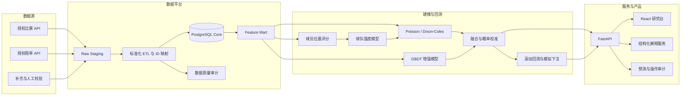
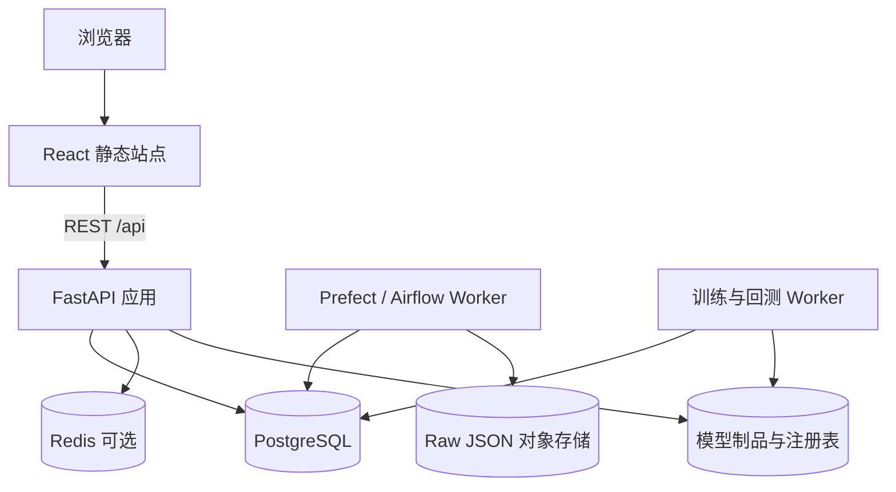

# 系统架构设计

## 1. 架构目标

系统不是“猜比分工具”，而是一个可版本化、可回放、可审计的足球量化研究与决策平台。架构围绕五条连续能力链构建：数据沉淀、球员评分、球队强度、概率预测、市场价值判断。

首版采用模块化单体，优先降低本地开发和调试成本；采集、训练和高频赔率快照可独立扩展为作业或服务，不在 MVP 阶段过早拆分微服务。

## 2. 逻辑架构

## 3. 部署视图

开发环境只需前端、FastAPI 与单个 PostgreSQL。生产环境再加入对象存储、作业编排、Redis、模型制品存储及只读副本。

## 4. 模块边界

| 模块 | 职责 | 关键输出 |
|---|---|---|
| `ingestion` | 限流、重试、原始响应落盘、增量游标 | raw payload、采集批次 |
| `etl` | Schema 校验、UTC 统一、实体与来源 ID 映射 | 标准比赛、球员、赔率记录 |
| `ratings` | 位置分桶、稳健 z-score、EWMA 状态分 | 球员评分、置信度 |
| `features` | 赛前快照、缺失标记、特征版本 | 不泄漏未来信息的特征行 |
| `models` | DC/Poisson、GBDT、融合与校准 | 概率分布、模型版本 |
| `backtest` | 时间序列滚动验证与模拟下注 | ROI、CLV、回撤、校准指标 |
| `serving` | 比赛、球员、球队、回测、运维 API | 版本化 JSON DTO |
| `dashboard` | 研究、解释、模拟观察、审计回放 | 可操作 Web UI |
| `ops` | DQ、延迟、告警、作业状态 | 运维健康状态 |

## 5. 核心数据流

1. 赛程按比赛日增量拉取，所有时间以 UTC 入库。
2. 赛前 24 小时开始拉取伤停与预计阵容；赛前 75 分钟提高刷新频率。
3. 赔率以快照方式写入，不更新覆盖历史值。
4. 赛后补拉事件、确认阵容、球员统计和封盘赔率，并执行 T+1 修复。
5. 特征服务为每个 `match_id + feature_version + as_of_utc` 生成不可变赛前快照。
6. 推理记录模型版本、特征版本、概率、市场快照和校准器版本。
7. 模拟下注只在风控闸门全部通过时生成，并保留结算、CLV 与审计记录。

## 6. 模型架构

- 基线层：Dixon-Coles / Poisson 输出比分分布与 1X2。
- 增强层：XGBoost/LightGBM 吸收状态、阵容、伤停、赛程密度与赔率漂移。
- 融合层：stacking 或受约束加权平均。
- 校准层：isotonic、sigmoid 或 temperature scaling，按联赛与市场记录版本。
- 解释层：只接收已经计算完成的结构化特征和预测结果，不重算概率、不修改风控。

### 当前已落地的历史概率基线

首个真实研究模型为 `rolling-poisson-dc-v1`：

- 只使用 `core.historical_matches` 中目标日期之前的正常完赛比分。
- 对同一天的全部比赛先统一预测，再统一更新结果，禁止同日赛果相互泄漏。
- 按联赛维护指数时间衰减的主客场攻防强度，并向联赛均值做小样本收缩。
- 用 Poisson 比分矩阵和固定低比分 Dixon-Coles 修正生成 1X2 概率。
- 每条预测保存测试日期、训练截止日、实际最大来源日期、输入指纹和模型版本。
- 历史赔率不进入训练特征；MarketAverage 封盘赔率仅用于赛后市场概率对照。

当前五大联赛 2024/25 的 1,750 条跨来源核验正常完赛样本外预测已写入
`analytics.historical_model_predictions`；另有 2 场判定比赛被排除。回测运行同时
保存比赛输入、市场赔率、模型实现和预测内容四类 SHA-256 指纹。由于全部历史赔率
都缺少逐条采集时间证明，模拟下注、ROI、CLV 和最大回撤仍由安全闸强制关闭。

## 7. 阶段闸门

| 阶段 | 系统能力 | 硬限制 |
|---|---|---|
| 数据采集期 | 数据仓、球员评分、赔率快照 | 不输出真实投注建议 |
| 预测期 | 样本外概率、校准监控 | 不暴露真实资金 |
| 模拟期 | edge、EV、模拟下注与审计 | 仅模拟观察 |
| 真实触发准备 | 小仓位规则与人工复核 | 必须满足样本、CLV、回撤、DQ 与合规条件 |

## 8. 非功能要求

- 审计：所有采集、特征、预测、赔率与模拟决策均可按时间回放。
- 幂等：采集和 ETL 以来源 ID 与业务唯一键保证重跑安全。
- 时区：`timestamptz` 入库，展示层转换为 `Asia/Shanghai`。
- 数据质量：每日计算 completeness、uniqueness、freshness、schema drift、cross-source mismatch。
- 恢复：每日 base backup、连续 WAL 归档、特征层小时级逻辑备份。
- 安全：密钥不入库；真实账户相关数据与比赛数据隔离并单独授权。
