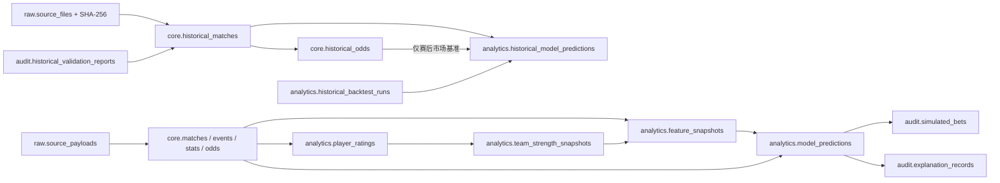

# 数据字典与血缘摘要

## 分层

| Schema | 数据性质 | 是否允许更新覆盖 |
|---|---|---|
| `raw` | 原始来源响应、采集批次和源文件版本 | 原始内容只追加；重复以哈希去重 |
| `core` | 标准化业务实体与时序事实 | 维表可更正；实时事件/快照只追加；历史文件按版本幂等替换 |
| `analytics` | 评分、特征、模型与回测 | 按版本只追加 |
| `audit` | DQ、模拟决策、解释和用户操作 | 不可变审计记录 |

## 关键业务主键

- 比赛：内部 `match_id`；来源 ID 通过 `source_entity_mappings` 映射。
- 历史比赛：`source_division + season_label + match_date + 主客队规范名` 唯一，
  每行必须关联 `raw.source_files` 和原始 CSV 行号/行哈希。
- 历史赔率：`hist_match_id + bookmaker + market_type + is_closing` 唯一；
  源文件修订时整场赔率集合替换，避免遗留旧值。
- 球员赛后统计：`match_id + player_id` 唯一。
- 赔率快照：`match + source + bookmaker + market + selection + captured_at` 唯一。
- 特征快照：`match + feature_version + as_of_utc` 唯一，防止未来信息泄漏。
- 预测：`match + model_version + predicted_at_utc` 唯一。
- 历史回测运行：`run_key` 唯一，由配置与历史输入 SHA-256 指纹共同生成。
- 历史预测：`historical_backtest_run_id + hist_match_id` 唯一，并强制
  `source_max_match_date <= training_cutoff_on < prediction_for_on`。

## 核心血缘

## 时间字段约定

- `event_time_utc`：数据描述的业务事件时间。
- `captured_at_utc`：系统抓到快照的时间。
- `ingested_at_utc`：原始记录落地时间。
- `as_of_utc`：评分或特征在该时刻可见的数据截面。
- `price_timing`：历史赔率的来源语义。2019/20 前为
  `preclosing_legacy`，之后区分 `opening` / `closing`。
- `point_in_time_safe`：赔率是否具有足以进入指定赛前截面的采集时间证明。
  Football-Data CSV 没有逐行采集时间，因此当前全部为 `false`。
- 所有生产时间字段使用 `timestamptz`，前端转换为用户时区。
- `prediction_for_on`：历史模型要预测的比赛日期。
- `training_cutoff_on`：该预测允许读取数据的最晚日期。
- `source_max_match_date`：算法实际读取的最新比赛日期，数据库约束其严格早于预测日。

## 历史真实性状态

- `unverified`：文件哈希和内部一致性校验通过，但尚未由独立来源逐场核验。
- `verified_normal`：独立来源确认正常完成的全场比分。
- `awarded`：结果由赛事机构裁定；比赛过程统计不可当作完整 90 分钟数据。
- 原始行哈希变化时，既有核验状态和核验质量标记自动失效。
